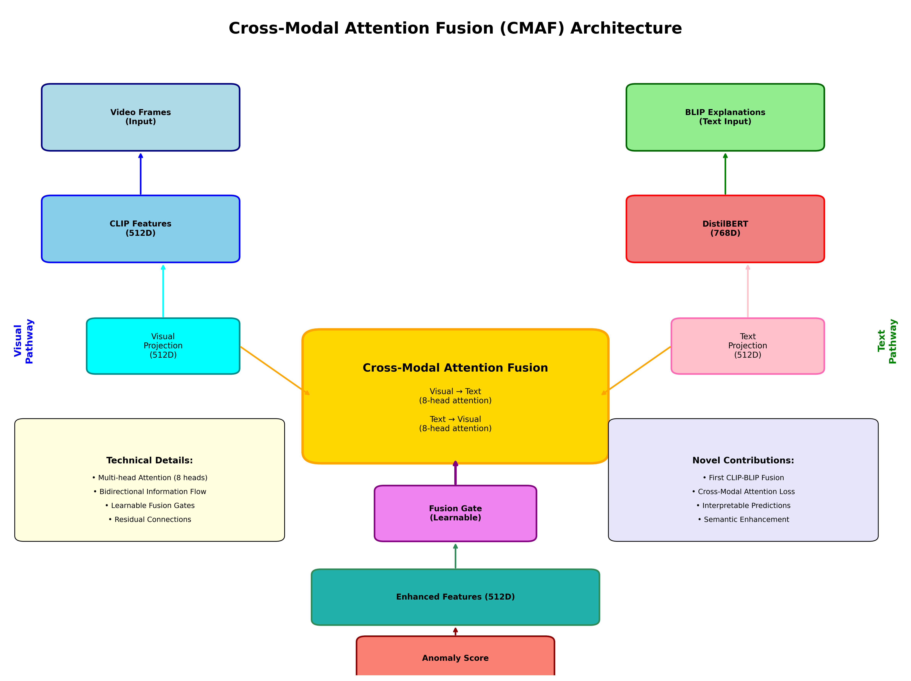

# ExVAD + CMAF: Explainable Video Anomaly Detection

Code for my paper [Enhancing Explainable Video Anomaly Detection using Cross-Modal Attention Fusion Mechanism](https://ieeexplore.ieee.org/document/11436826) (Hrishikesh Muniraju, Sridhar Raj S), IEEE IConSCEPT 2025.

The model flags anomalous surveillance videos from UCF-Crime and gives a short caption of what is happening as the explanation.



## Method

- CLIP ViT-B/32 encodes 16 frames per video. The frame features are averaged into one 512-d vector.
- BLIP captions the frames, and DistilBERT encodes the caption (768-d).
- CMAF (`src/models/cross_modal_attention.py`) does the fusion:
  - it projects both vectors to 512-d
  - it runs 8-head attention in both directions, visual to text and text to visual
  - it mixes the two results with a learned sigmoid gate
  - it adds the result back to the CLIP feature as a residual
- A small MLP head gives the anomaly score.

## Results

UCF-Crime test split, 290 videos (150 normal, 140 anomalous), video-level labels:

| Model | Accuracy | Precision | Recall | F1 | AUC-ROC | Missed anomalies |
|---|---:|---:|---:|---:|---:|---:|
| ExVAD baseline | 0.807 | 0.792 | 0.814 | 0.803 | 0.898 | 26 |
| ExVAD + CMAF | 0.828 | 0.781 | 0.893 | 0.833 | 0.909 | 15 |

- **Detections:** CMAF catches 11 more anomalous videos than the baseline, with 5 more false alarms.
- **Per class:** the largest gains are on Shoplifting (16 to 19 of 21), Burglary (11 to 13 of 13) and Shooting (19 to 21 of 23).
- **Thresholds:** CMAF uses a threshold of 0.149, tuned on this split. The baseline uses 0.5.
- **Saved outputs:** the per-video scores and tables are in `results/`.
- **Paper numbers:** the paper reports 85.7% (+7.5 over the baseline) from the evaluation at publication time.

### Reproducing the numbers

All metrics above can be recomputed from the saved scores without the dataset or a GPU:

```bash
pip install -r requirements-ci.txt
python -m src.evaluation.report results/cmaf_per_video_scores_test290.json --out results/report
pytest
```

- **Report output:** a metrics table, a JSON file and an ROC curve.
- **Tests:** `tests/test_report.py` checks that the numbers in this README match the saved scores.
- **CI:** GitHub Actions runs the checks and linting on every push.

## Temporal extension

`temporal_extension/` adds a temporal branch (Transformer, BiLSTM and a frame-difference motion encoder) and a confidence-gated rule. The rule only changes the CMAF score when the temporal branch is confident. This part is not in the paper.

| Model | Accuracy | F1 | False alarms |
|---|---:|---:|---:|
| ExVAD + CMAF | 0.828 | 0.833 | 35 |
| + Temporal | 0.862 | 0.856 | 19 |

## Repository

```
src/models/            aegm.py (BLIP), madm.py (CLIP baseline), cross_modal_attention.py (CMAF), enhanced_exvad_model.py
src/utils/             data loading, frame sampling, metrics, threshold tuning
src/train.py           baseline training
src/train_enhanced.py  CMAF training
src/evaluate_cmaf_comprehensive.py
src/evaluation/report.py  metrics, per-class results and ROC from saved scores
tests/                 pytest checks for the reported numbers
scripts/               demo and attention visualization
notebooks/             Kaggle notebook
results/               per-video scores and metric tables
temporal_extension/    temporal branch
```

## Usage

```bash
pip install -r requirements.txt
python -m src.train
cd src && python train_enhanced.py
python -m src.evaluate_cmaf_comprehensive
python scripts/demo_cmaf.py
```

UCF-Crime frames go in `data/Train/<Class>/` and `data/Test/<Class>/`. The dataset and model checkpoints are not included.

## Citation

```bibtex
@inproceedings{muniraju2025cmaf,
  title     = {Enhancing Explainable Video Anomaly Detection using Cross-Modal Attention Fusion Mechanism},
  author    = {Muniraju, Hrishikesh and Raj S, Sridhar},
  booktitle = {2025 International Conference on Signal Processing, Computation, Electronics, Power and Telecommunication (IConSCEPT)},
  year      = {2025},
  publisher = {IEEE},
  url       = {https://ieeexplore.ieee.org/document/11436826}
}
```
